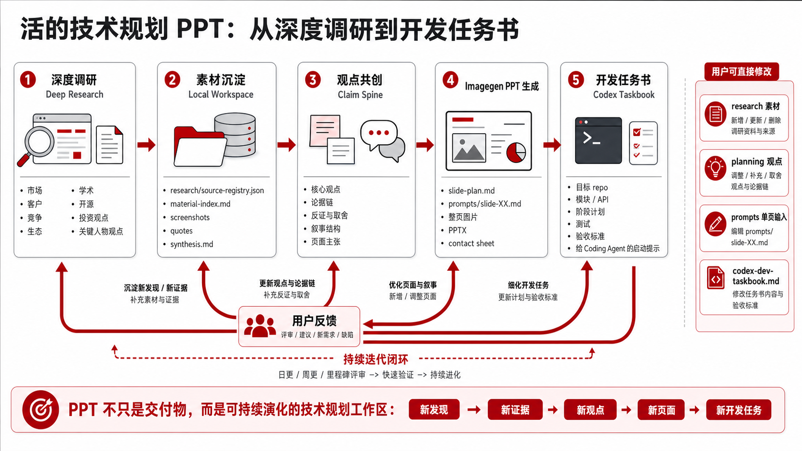

# Huawei PPT Skills

面向中文企业汇报与技术规划的两个 Codex skills，通过 imagegen 生成整页图片并组装为 16:9 PPTX。

## 选择 Skill

| Skill | 适用任务 |
| --- | --- |
| [huawei-style-ppt](skills/huawei-style-ppt/SKILL.md) | 企业汇报、架构、机制、场景、比较表和路线图，支持**汇报版**与**生动版**。 |
| [huawei-tech-planning-ppt](skills/huawei-tech-planning-ppt/SKILL.md) | 从深度调研、洞察与策略到技术规划 PPT，并可继续形成开发任务书和讲解包。 |

## 汇报版与生动版

两种风格共用白底、黑标题、灰色结构和克制的红色强调，均输出整页图片式 PPTX。

| 风格 | 适合表达什么 | 视觉特点 |
| --- | --- | --- |
| **汇报版（默认）** | 管理汇报、董事会规划、证据分析、能力矩阵 | 延续原有正式、克制的图表和结构化版式，以观点、证据与决策为中心。 |
| **生动版** | 技术架构、协作流程、问题分析、业务场景 | 用人物、友好 Agent、文件、设备和系统说明角色、动作、信息流与价值，保留必要技术细节。 |

明确指定风格时直接采用；未指定且没有参考风格时默认汇报版。生动版不意味着每页都要加角色，也不意味着删减内容：完整方案表格仍可采用文字为主的版式。

生动版示例，依次为方案总览、可信整理机制、详细方案表格：


详细规范：[汇报版](skills/huawei-style-ppt/references/style-guide.md) · [生动版](skills/huawei-style-ppt/references/lively-style.md)

### 使用示例

```text
Use $huawei-style-ppt 汇报版，做一份年度能力建设汇报，突出观点、证据、能力矩阵和路线图。
```

```text
Use $huawei-style-ppt 生动版，做一份企业上下文平台架构 PPT。
用具体的人物、Agent、文件和系统说明协作，标清外部查询、用户反馈和数据流。
```

```text
Use $huawei-style-ppt 生动版，把七项挑战、具体处理方案和核心技术放在一页表格中。
保留已经确认的完整处理过程，不要缩成短语；这页不需要人物插画。
```

修改已有 PPT 时，可以只重生成指定页面并重新打包，其余页面保持原样。

## 技术规划工作流

`huawei-tech-planning-ppt` 是保留原始研究、观点、页稿和提示词的持续工作区：

**深度调研 → 洞察与策略 → 逐页规划 → imagegen 生成 → 反馈迭代 → 开发任务书或讲解包**



按当前目标用自然语言发起即可：

```text
Use $huawei-tech-planning-ppt 帮我做一个 XXX 主题的技术规划 PPT。
先明确写作方向、调研重点、已有观点、信息密度和决策用途，再深入调研、提炼策略并生成。
关键技术要讲清问题、原理、模块/接口/流程、评价方法和量化目标。
```

```text
Use $huawei-tech-planning-ppt 围绕 XXX 做深度调研，保存来源、截图、材料索引和研究综合，暂不生成 PPT。
```

```text
Use $huawei-tech-planning-ppt 基于 outputs/xxx 补充客户、买点和技术趋势分析，
更新观点和页稿；只重生成受到影响的页面。
```

```text
Use $huawei-tech-planning-ppt 基于 outputs/xxx 的规划成果，
生成交给 Codex 继续开发的任务书，目标 repo 是 /path/to/repo。
```

```text
Use $huawei-tech-planning-ppt 基于 outputs/xxx 生成讲稿和技术讲解包。
视频采用克制科技风，先讲清场景、挑战、架构、技术与价值，再按可用工具生成。
```

工作区通常保留：

```text
outputs/<deck-name>/
  research/   # 原始资料、来源索引、截图与研究综合
  planning/   # 观点、策略、slide plan、开发任务书
  prompts/    # 每页 imagegen 输入
  images/     # 最终页面图片
  output/     # PPTX 与 contact sheet
```

通用 skill 的两种视觉版本不改变技术规划 skill 自己的调研流程；如需规划页复用生动版，可在请求中明确指定，并参照上述视觉规范。

## 安装到 Codex

可直接对 Codex 说：

> 请安装 https://github.com/jackylk/huawei-ppt-skills 中的 huawei-style-ppt 和 huawei-tech-planning-ppt，复制到本机 skills 目录，检查 python-pptx 与 Pillow 依赖，并说明是否需要重启以重新发现技能。

手工安装：

```bash
git clone https://github.com/jackylk/huawei-ppt-skills.git
mkdir -p ~/.codex/skills
cp -R huawei-ppt-skills/skills/huawei-style-ppt ~/.codex/skills/
cp -R huawei-ppt-skills/skills/huawei-tech-planning-ppt ~/.codex/skills/
python3 -m pip install python-pptx Pillow
```

访问受限的仓库需要先获得权限。安装或更新后，重新启动会话或按客户端要求重新发现 skills。更新仓库不会自动同步已安装的技能副本。

## 在 Claude Code 中使用

```bash
mkdir -p ~/.claude/skills
cp -R huawei-ppt-skills/skills/huawei-style-ppt ~/.claude/skills/
cp -R huawei-ppt-skills/skills/huawei-tech-planning-ppt ~/.claude/skills/
```

完整生成图片页需要运行环境提供图像生成工具；没有工具时，可以编写页稿和提示词，但不能声称已经生成最终图片页。

## 输出与原图保真

- PPTX 每页是一张整页图片，文字和图形不能逐项编辑；保留页稿、提示词及源素材以便修改。
- 两个 skills 都带有 `scripts/make_image_pptx.py`，把 PNG 按顺序打包成 16:9 PPTX；依赖 `python-pptx`。
- 保留论文原图、官方图表或截图时，先保存原始素材，在 imagegen 页面中预留位置，再用 `scripts/embed_source_figures.py` 嵌入；依赖 Pillow。不要把重绘结果称为原图。
- 生成后检查文字、箭头方向、系统边界和表格最后一行；超过三页时检查整套预览。
